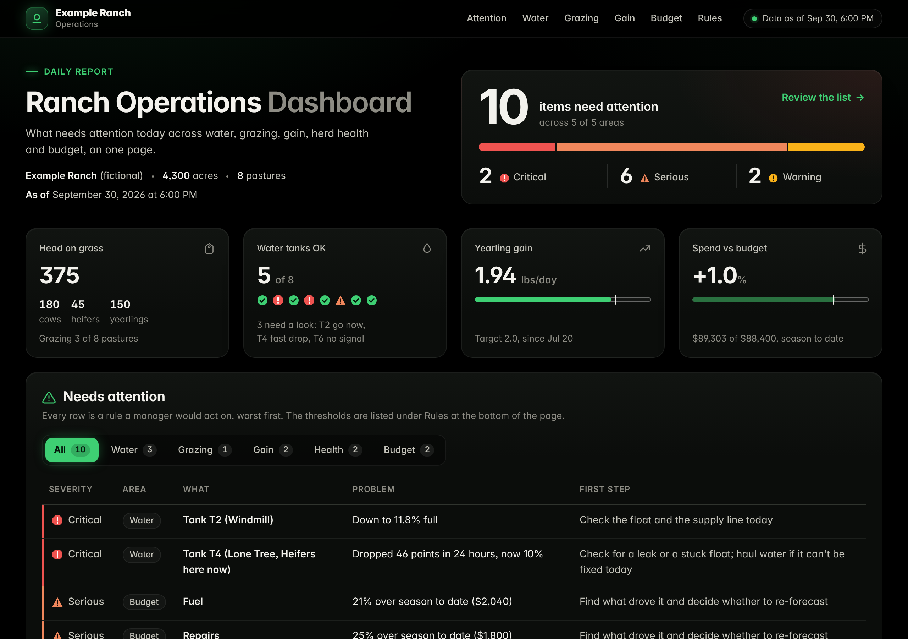
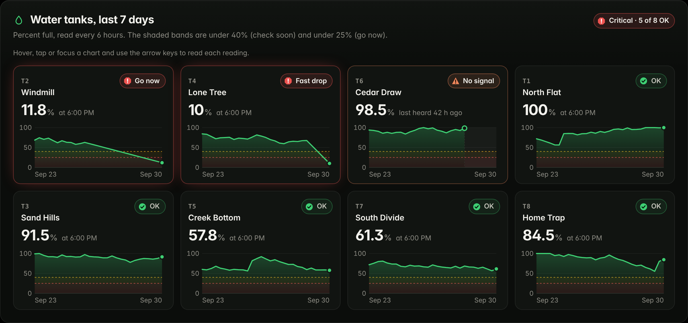
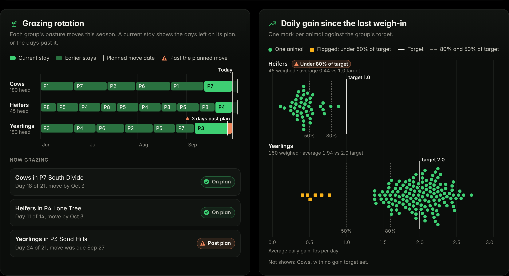
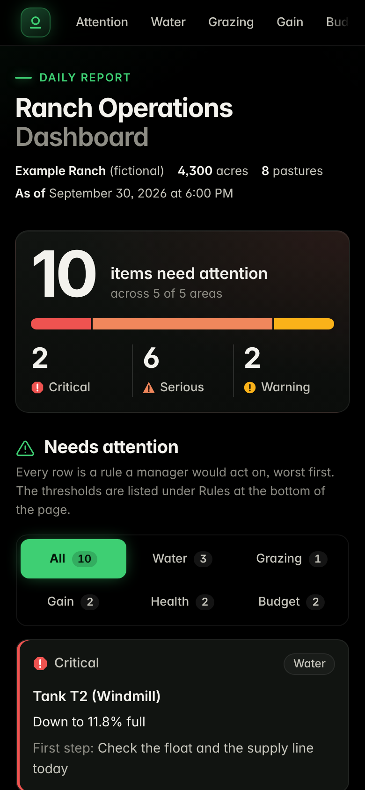

# Ranch Operations Dashboard

One page that answers a ranch manager's first question each morning: **what needs my attention today?** It pulls
together water tank sensors, the grazing rotation, weigh-ins, herd health tasks and the budget, runs them through a
short list of rules, and puts the problems at the top, worst first, each with a first step to take.

**Try it:** https://cowcampstx.github.io/ranch-ops-dashboard/



> Example Ranch and all of its data are fictional. `scripts/generate_data.py` builds them from a fixed seed.

## Exception reporting

Charts are useful, but a busy manager shouldn't have to read eight of them to find the one tank that's leaking.
The exception report does that reading. Each rule is a threshold someone would actually act on:

| Area | Severity | Flags when |
|---|---|---|
| Water | Critical | Level under 25%, or a drop of 30+ points in 24 hours (a leak or a stuck float) |
| Water | Serious | No reading for 24 hours (the sensor's last level can't be trusted, so it isn't judged) |
| Water | Warning | Level under 40% |
| Grazing | Serious | A group is past its pasture's planned graze days |
| Grazing | Warning | A planned move is 2 days away or less |
| Gain | Serious | A group's average daily gain is under 80% of target since the last weigh-in |
| Gain | Warning | Individual animals under 50% of target (skipped when the whole group is already flagged) |
| Health | Serious / Warning | An open task is overdue / due within 7 days |
| Budget | Serious / Warning | A category is more than 10% / 5-10% over budget, season to date |

Some design choices:
- **Worst first, with a first step.** Every row says what's wrong and what to do about it, so it can go straight to a
  crew lead.
- **No noise.** A silent sensor isn't also flagged as low, and a group-wide gain problem isn't repeated for each
  animal. On the example data the report finds exactly the 10 problems that were planted and nothing else; a test
  checks this.
- **Context where it matters.** A water alert names the group grazing that pasture right now.
- **Severity is never color alone.** Each level has its own icon shape and a text label.
- **Thresholds in one place** (`RULES` in `exceptions.js`), so a ranch can tune them to its own operation.

## The charts

| Chart | What it shows |
|---|---|
| Water tanks, last 7 days | One chart per tank with shaded bands under 40% and 25%, the latest level and a status label; a silent sensor shows where data stops |
| Grazing rotation | Each group's pasture moves for the season, the days each plan has left and any days past the planned move, plus where each group is grazing now |
| Daily gain | One mark per animal against the group's target and its 80% and 50% lines, with the animals the report flags highlighted |
| Spending against budget | One table: each category's percent over or under as a bar, beside its budget, actual and difference |




Every chart can be read with a mouse, a tap or the keyboard (focus a chart and use the arrow keys), and each is drawn
at the size it's shown, so its text stays readable on a phone. On a phone the report turns into cards and the tables
fit the screen. The page uses a dark theme, and it has no dependencies or build step.



## The example data

`scripts/generate_data.py` (Python standard library) writes the CSVs in `data/`: a fictional 4,300-acre operation with
180 cow-calf pairs, 45 first-calf heifers and 150 yearling steers across 8 pastures, June 1 to September 30, 2026.

| File | Rows | What's in it |
|---|---|---|
| `pastures.csv` | 8 | acres, planned graze days per move, minimum rest days |
| `groups.csv` | 3 | head count and target daily gain |
| `moves.csv` | 23 | each group's pasture moves; the current stay has no out date |
| `weights.csv` | 585 | individual weigh-ins on June 1, July 20 and September 15 |
| `water.csv` | 953 | tank level every 6 hours for September |
| `health.csv` | 6 | herd health tasks with due dates |
| `budget.csv` | 24 | monthly budget and actual by category |

Problems planted on purpose, so the report has something real to find: a leaking tank (T4), a sensor that stops
reporting (T6), a tank running low (T2), yearlings left 3 days past their move, heifers gaining well under target, six
slow-gaining yearlings, an overdue booster, a pinkeye check due this week, and fuel and repairs over budget.

To use real data, replace the CSVs with exports in the same columns.

## Run it locally

```bash
python -m http.server 8000             # then open http://localhost:8000
node --test tests/exceptions.test.mjs  # 8 tests: every planted problem found, no false alarms, rule thresholds
python scripts/generate_data.py        # rebuild the example data (same output every time)
```

## Files

```
index.html               the page and its styles
app.js                   loads the CSVs, draws the tiles, report and charts
exceptions.js            the rules and summaries: pure functions shared by the page and the tests
data/                    the fictional example data
scripts/generate_data.py builds data/ from a fixed seed
tests/                   node:test unit tests
docs/                    documentation: start at docs/README.md (status, decisions, reviews, the audit and plan)
docs/screenshots/        the images on this page and the script that takes them
AGENTS.md                instructions for coding agents (Claude and Codex); CLAUDE.md points to it
```

## License

MIT
